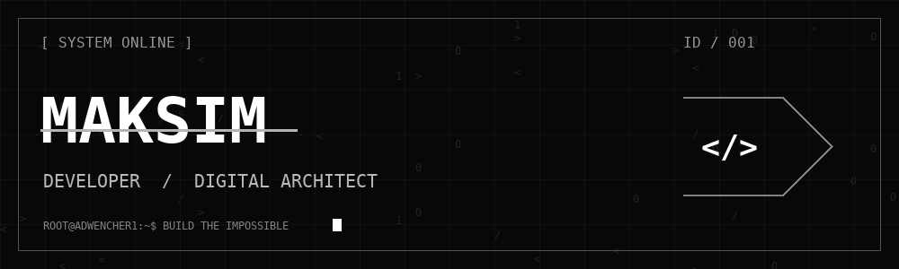

<div align="center">



### `MAKSIM // ADWENCHER1`

**SENIOR DEVELOPER · SYSTEM ARCHITECT · DIGITAL CREATOR**


`[ CODE. CREATE. REPEAT. ]`

</div>

---

### `01 / WHOAMI`

Привет, я **Максим**. Превращаю идеи в цифровые продукты: от первых строк кода до архитектуры готовой системы. Люблю сложные задачи, чистый код и интерфейсы, в которых каждая деталь на своём месте.

```console
root@adwencher1:~$ cat mission.txt
> build meaningful things
> solve problems creatively
> never stop learning_
```

### `02 / TECH ARSENAL`

```text
LANGUAGES      JavaScript · TypeScript · Python · Go · C++ · SQL
FRONTEND       React · Next.js · HTML5 · CSS3 · Tailwind CSS
BACKEND        Node.js · NestJS · Express · FastAPI · GraphQL
DATABASES      PostgreSQL · MySQL · MongoDB · Redis
INFRASTRUCTURE Linux · Docker · Kubernetes · Nginx · CI/CD
TOOLKIT        Git · REST API · Testing · System Design
```

### `03 / OPERATING PRINCIPLES`

**01.** Думать системно &nbsp; / &nbsp; **02.** Создавать осознанно &nbsp; / &nbsp; **03.** Постоянно улучшать

---

<div align="center">

### `ACCESS GRANTED_`

**BUILD THE IMPOSSIBLE.**

<sub>MAKSIM © DIGITAL SPACE &nbsp; // &nbsp; NO LIMITS. JUST CODE.</sub>

</div>
